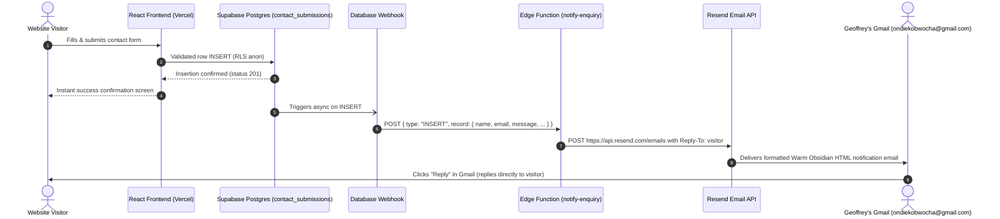

# Automatic Email Notifications Setup Guide (Option A)

This document provides step-by-step instructions for deploying and activating the **Supabase Edge Function (`notify-enquiry`)** and **Database Webhook** to automatically forward portfolio contact submissions directly to your email inbox (`ondiekobwocha@gmail.com`).

---

## 1. Architectural Overview



### Why this architecture is production-grade
1. **Zero Secret Leakage:** The `RESEND_API_KEY` stays exclusively on Supabase's secure server environment. It never touches client code or Vite bundles.
2. **Instant Visitor UX:** The contact form returns in under 150ms upon Postgres insertion. The visitor never waits on third-party email delivery networks.
3. **Pre-configured `Reply-To` Header:** Hitting **Reply** in Gmail responds directly to the visitor (`${name} <${email}>`).
4. **Brand-Aligned Formatting:** Includes client metadata, project category, timestamp in both East Africa Time (`EAT / UTC+3`) and UTC, and an escaped pre-wrap message block with International Vermilion accents.

---

## 2. Step 1: Obtain a Free Resend API Key

1. Visit **[resend.com](https://resend.com)** and create or log into your account using `ondiekobwocha@gmail.com`.
2. In the left navigation, go to **API Keys**.
3. Click **Create API Key**:
   - **Name:** `Portfolio Notifications`
   - **Permission:** `Full access` (or `Sending access`)
   - **Domain:** `All domains`
4. Copy your API key (starts with `re_...`). Keep it confidential.

> [!NOTE]
> On Resend's free tier, sending from `onboarding@resend.dev` to your registered account email (`ondiekobwocha@gmail.com`) works immediately with **zero domain verification** required!
> If you later connect a custom domain (e.g. `gobwocha.com`), you can set `NOTIFICATION_SENDER_EMAIL="Geoffrey Obwocha <contact@gobwocha.com>"`.

---

## 3. Step 2: Configure Secrets in Supabase

You can set your secret using either the **Supabase Web Dashboard** or the **Supabase CLI**.

### Option 2A: Via Supabase Web Dashboard (Easiest)
1. Open your **[Supabase Dashboard](https://supabase.com/dashboard/project/gobwocha-portfolio)**.
2. Navigate to **Project Settings** (gear icon at the bottom left) -> **Edge Functions**.
3. Under **Secrets**, click **Add new secret**:
   - **Name:** `RESEND_API_KEY`
   - **Value:** `re_your_actual_key_here`
4. Click **Save**.

### Option 2B: Via Supabase CLI (Terminal)
If you are logged into Supabase CLI (`npx supabase login`):
```bash
npx supabase secrets set RESEND_API_KEY=re_your_actual_key_here --project-ref your-project-id
```

*(Optional variables: `NOTIFICATION_RECIPIENT_EMAIL` defaults to `ondiekobwocha@gmail.com`; `NOTIFICATION_SENDER_EMAIL` defaults to `Portfolio Enquiries <onboarding@resend.dev>`)*.

---

## 4. Step 3: Deploy the Edge Function

We have added a convenience script in `package.json`:

```bash
npm run deploy:function
```

Or using the Supabase CLI directly:
```bash
npx supabase functions deploy notify-enquiry --no-verify-jwt
```

> [!TIP]
> `--no-verify-jwt` allows Supabase Database Webhooks to trigger the function without requiring an end-user JWT token.

---

## 5. Step 4: Create the Database Webhook

Connect the `public.contact_submissions` table to the `notify-enquiry` Edge Function:

1. In the **Supabase Dashboard**, open **Database** in the left sidebar.
2. Select **Webhooks** (or go to **Integrations** -> **Database Webhooks**).
3. Click **Create a new webhook** (or **Enable Webhooks** if it's your first time).
4. Fill in the webhook form:
   - **Name:** `notify-enquiry-webhook`
   - **Table:** `contact_submissions` (Schema: `public`)
   - **Events:** Check **`Insert`** only (leave Update and Delete unchecked).
   - **Type of Webhook:** Select **`Supabase Edge Functions`**.
   - **Edge Function:** Select **`notify-enquiry`**.
   - **HTTP Method:** `POST`.
   - **Timeout:** `5000` ms (default).
5. Click **Create webhook**.

> [!WARNING]
> ### Fixing `ERROR: 42883: function supabase_functions.http_request() does not exist`
> If the Supabase Dashboard displays this error when creating the webhook, it means the `pg_net` extension or `supabase_functions` schema hasn't been initialized in your database yet.
> 
> **Quick Fix (Run in Supabase SQL Editor):**
> Open **SQL Editor** in your Supabase Dashboard, paste the following SQL, and click **Run**:
> ```sql
> -- 1. Enable pg_net extension
> create extension if not exists pg_net;
> 
> -- 2. Ensure schema exists
> create schema if not exists supabase_functions;
> 
> -- 3. Create the http_request trigger function
> create or replace function supabase_functions.http_request()
> returns trigger
> language plpgsql
> security definer
> as $$
> declare
>     request_id bigint;
>     payload jsonb;
>     url text := tg_argv[0]::text;
>     method text := tg_argv[1]::text;
>     headers jsonb := tg_argv[2]::jsonb;
>     params jsonb := coalesce(tg_argv[3]::jsonb, '{}'::jsonb);
>     timeout_ms integer := coalesce(tg_argv[4]::integer, 5000);
> begin
>     payload := jsonb_build_object(
>         'type', tg_op,
>         'table', tg_table_name,
>         'schema', tg_table_schema,
>         'record', case when tg_op in ('INSERT', 'UPDATE') then row_to_json(new) else null end,
>         'old_record', case when tg_op in ('UPDATE', 'DELETE') then row_to_json(old) else null end
>     );
> 
>     if upper(method) = 'POST' then
>         select net.http_post(
>             url := url,
>             body := payload,
>             params := params,
>             headers := headers,
>             timeout_milliseconds := timeout_ms
>         ) into request_id;
>     end if;
> 
>     return new;
> end;
> $$;
> ```
> Once executed, either create the webhook in the Dashboard again, or run this direct SQL trigger:
> ```sql
> drop trigger if exists "notify-enquiry-webhook" on public.contact_submissions;
> 
> create trigger "notify-enquiry-webhook"
> after insert on public.contact_submissions
> for each row
> execute function supabase_functions.http_request(
>   'https://YOUR_PROJECT_ID.supabase.co/functions/v1/notify-enquiry',
>   'POST',
>   '{"Content-Type": "application/json"}',
>   '{}',
>   '5000'
> );
> ```

---

## 6. Step 5: Test and Verify

1. Go to your live contact page: **[`https://gobwocha.vercel.app/contact`](https://gobwocha.vercel.app/contact)**.
2. Submit a test enquiry with your name and message.
3. Check your Gmail inbox (`ondiekobwocha@gmail.com`):
   - You will receive a structured email notification with subject `[Portfolio Enquiry] <Name> — <Project Scope>`.
   - Hit **Reply** in Gmail to confirm the `To:` field defaults to the visitor's email address.
4. Verify execution logs:
   - In Supabase Dashboard, go to **Edge Functions** -> **`notify-enquiry`** -> **Logs** to view the status `200 OK` dispatch log.

---

## 7. Automated Test Coverage

The Edge Function handler and its validation/formatting helpers are covered by 21 automated unit tests in `src/lib/supabase/notifyEnquiry.test.ts`:
- Webhook `INSERT` payload vs direct POST payload extraction.
- XSS prevention / HTML character escaping in emails.
- Project type label resolution and fallback handling.
- East Africa Time (`EAT / UTC+3`) and UTC timestamp formatting.
- Authorization header and optional `WEBHOOK_SECRET` verification.
- Mocked Resend HTTP API success and upstream error handling.

To re-run the tests anytime:
```bash
npm run test -- src/lib/supabase/notifyEnquiry.test.ts
```
