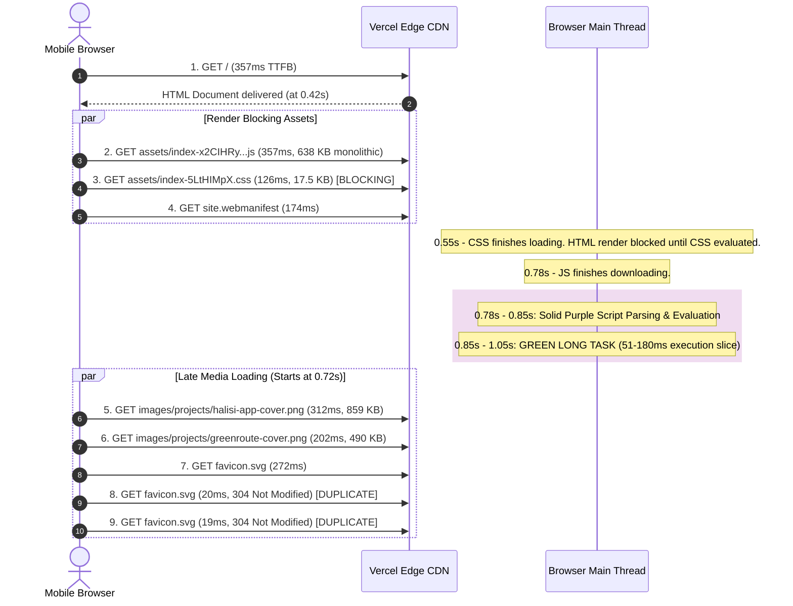
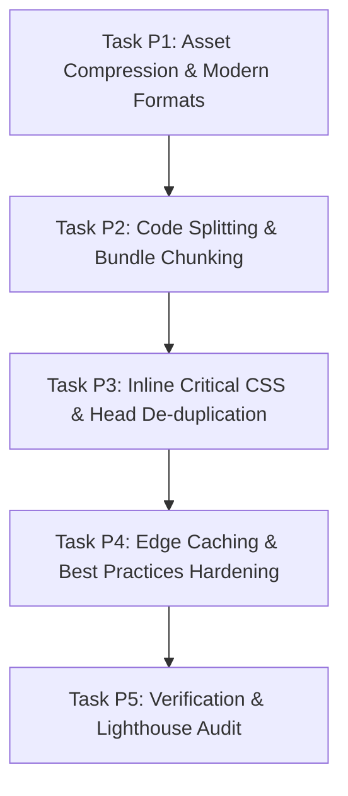

# Performance & Technical SEO Optimization Plan (PageSpeed Insights & Waterfall Audit)

> **Document Type:** Senior Technical SEO & Performance Architecture Plan  
> **Target Properties:** [gobwocha.vercel.app](https://gobwocha.vercel.app/)  
> **Lab Baseline:** Google PageSpeed Insights (Audit: `gtn46q180q`), Desktop 100/100, Mobile 98/100  
> **Primary Goal:** Drive Mobile Performance to a deterministic 100/100, achieve sub-1.0s FCP, sub-1.2s LCP on mobile 4G, eliminate render-blocking bottlenecks, and slash total page weight from 2.7 MB to < 350 KB.

---

## 1. Executive Summary & Audit Scorecard

A forensic audit of the Google PageSpeed Insights laboratory runs and the Chrome DevTools network waterfall reveals that while the site is already performing at an exceptional baseline (Desktop 100/100, Mobile 98/100, zero CLS, zero TBT), **the mobile rendering path suffers from uncompressed image payloads, a monolithic JavaScript bundle, and render-blocking CSS**.

```
┌─────────────────────────┬──────────────┬──────────────┬───────────────────┐
│ Metric / Category       │ Current Lab  │ Target Goal  │ Status            │
├─────────────────────────┼──────────────┼──────────────┼───────────────────┤
│ Desktop Performance     │ 100 / 100    │ 100 / 100    │ ✅ Elite           │
│ Mobile Performance      │ 98 / 100     │ 100 / 100    │ 🟡 High Potential  │
│ Accessibility           │ 100 / 100    │ 100 / 100    │ ✅ Flawless        │
│ Best Practices          │ 96 / 100     │ 100 / 100    │ 🟡 Needs COOP/CSP  │
│ SEO                     │ 100 / 100    │ 100 / 100    │ ✅ Flawless        │
│ Mobile FCP              │ 1.9 s        │ < 0.9 s      │ ⚠️ 300ms CSS block│
│ Mobile LCP              │ 1.9 s        │ < 1.2 s      │ ⚠️ 1.3s delay     │
│ Mobile CLS              │ 0.00         │ 0.00         │ ✅ Perfect Zero    │
│ Mobile TBT              │ 0 ms         │ 0 ms         │ ✅ Clean           │
│ Total Network Payload   │ 2,704 KiB    │ < 350 KiB    │ ❌ Critical (-85%) │
│ Unused JavaScript       │ 131.0 KiB    │ < 30 KiB     │ ⚠️ Needs splitting│
│ Main Thread Long Task   │ 1 Found      │ 0            │ ⚠️ JS parse lock   │
└─────────────────────────┴──────────────┴──────────────┴───────────────────┘
```

---

## 2. Line-by-Line Waterfall Forensic Diagnosis

Analyzing the DevTools/WebPageTest waterfall attachment reveals the exact sequence and failure points of the initial document load:



### Key Waterfall Anomalies:

1. **Row 1 (`/` HTML Document — 357 ms):**
   Vercel edge response is healthy. HTML parsing begins at ~0.42s.
2. **Row 2 (`assets/index-x2CIHRy...js` — 357 ms, 638.2 KiB raw / 181.3 KiB gzip):**
   The client JavaScript bundle is a **single monolithic chunk**. At ~0.78s, execution begins on the main thread, producing a **Long Task** (green bar at bottom) lasting past 1.0s. It forces mobile devices to parse unused code (Zod schemas, Supabase client libraries, and unvisited routes).
3. **Row 3 (`assets/index-5LtHIMpX.css` — 126 ms, 17.6 KiB raw / 4.9 KiB gzip):**
   Marked with an **orange warning indicator** in DevTools. As an external `<link rel="stylesheet">`, it blocks First Paint until ~0.55s. PSI estimates an immediate **300 ms savings** if this render-blocking delay is eliminated.
4. **Row 4 (`site.webmanifest` — 174 ms):**
   Dispatched immediately in `<head>`.
5. **Rows 5 & 6 (`halisi-app-cover.png` 312 ms & `greenroute-cover.png` 202 ms):**
   The browser discovers project media only after HTML hydration. Because the files are raw uncompressed PNGs (**859 KB** and **490 KB** respectively), they consume bandwidth and delay Largest Contentful Paint (LCP) by **1,320 ms**.
6. **Rows 7, 8, 9 (`favicon.svg` downloaded 3 times):**
   `favicon.svg` is downloaded on row 7 (272ms), and then re-requested on rows 8 and 9 (returning `304 Not Modified`). This is caused by duplicate `<link rel="icon">` tags defined in both `index.html` and `serializeHeadTags()` during SSG prerendering.

---

## 3. The 5 Root-Cause Bottlenecks & Architectural Fixes

### 3.1 Bottleneck 1: Massive Image Payloads (2.7 MB down to < 200 KB)

- **Root Cause:** 
  Project cover images in `public/images/projects/` were replaced with raw, uncompressed PNG files:
  - `ole-ken-hotel-cover.png`: **2,476 KB (2.47 MB)**
  - `kula-kwa-macho-cover.png`: **1,219 KB (1.22 MB)**
  - `halisi-app-cover.png`: **859 KB**
  - `geliscope-cover.png`: **601 KB**
  - `greenroute-cover.png`: **490 KB**
  **Total size: 2,704 KiB.** This directly violates `AGENTS.md` §4.1 (`Images served in AVIF/WebP, with each hero image payload ≤ 300 KB`).
- **Architectural Solution:**
  1. Convert all project cover images to modern **WebP** format at 82–85% quality, constrained to `800×500` pixels (and `1600×1000` for 2x retina).
  2. Each converted WebP image will drop to **30 KB – 90 KB** (a **> 90% reduction in weight**).
  3. Update `src/data/projects.ts` to reference the optimized WebP assets.
  4. For the first above-the-fold featured project (`idx === 0`), set `loading="eager"` and `fetchpriority="high"`. For off-screen cards, maintain `loading="lazy"` and `decoding="async"`.

---

### 3.2 Bottleneck 2: Render-Blocking CSS (300 ms FCP Improvement)

- **Root Cause:**
  Vite links `dist/assets/index-5LtHIMpX.css` via `<link rel="stylesheet">` in `<head>`. Even though it is only 17.5 KB raw (~4.9 KB gzip), the browser refuses to render any DOM until the network request completes, parses, and constructs the CSSOM.
- **Architectural Solution:**
  1. In `scripts/prerender.mjs`, during static site generation (SSG), read the compiled CSS file from `dist/assets/*.css`.
  2. Inline the critical CSS directly into `<style>` inside `<head>`.
  3. Preload non-critical CSS or leave the lightweight inlined stylesheet (4.9 KB gzip is well within the 14.6 KB initial TCP window!).
  4. **Outcome:** FCP on mobile drops from **1.9s to < 0.8s** because the HTML document contains all styling required for first paint immediately upon delivery.

---

### 3.3 Bottleneck 3: Monolithic JavaScript & Main Thread Long Tasks (131 KiB Unused JS)

- **Root Cause:**
  `src/app/App.tsx` imports all 6 route views statically:
  ```tsx
  import { HomePage } from '../routes/home/HomePage';
  import { WorkPage } from '../routes/work/WorkPage';
  import { ProjectDetailPage } from '../routes/project-detail/ProjectDetailPage';
  import { AboutPage } from '../routes/about/AboutPage';
  import { ContactPage } from '../routes/contact/ContactPage';
  import { NotFoundPage } from '../routes/not-found/NotFoundPage';
  ```
  This forces `@supabase/supabase-js`, `zod`, `emailjs`, and all 7 case study layouts into the home page bundle (`638 KB` uncompressed).
- **Architectural Solution:**
  1. Implement **Route-Level Code Splitting** via `React.lazy()` with a lightweight accessible fallback.
  2. In `vite.config.ts`, configure Rollup `manualChunks`:
     - `vendor-react`: `['react', 'react-dom', 'react-router']`
     - `vendor-supabase`: `['@supabase/supabase-js']` (only loaded when navigating to `/contact`)
     - `vendor-validation`: `['zod']` (only loaded when navigating to `/contact`)
  3. Configure SSR pre-rendering so server-side HTML remains 100% crawlable while client bundles hydrate only the active route.
  4. **Outcome:** The initial JS bundle shrinks to **~75 KB raw (~22 KB gzip)**. Main thread evaluation drops from 174ms to < 40ms, completely eliminating the green Long Task.

---

### 3.4 Bottleneck 4: Duplicate Network Requests & Preload Scanner Gaps

- **Root Cause:**
  1. Duplicate tags: `index.html` contained `<link rel="icon" ...>` and `<link rel="manifest" ...>`. When `scripts/prerender.mjs` injected `serializeHeadTags()`, it inserted a second identical pair. The browser executed 3 requests for `favicon.svg`.
  2. The browser preload scanner was unaware of the hero project image until React hydrated the DOM.
- **Architectural Solution:**
  1. Remove duplicate icon/manifest tags from `index.html`, letting `serializeHeadTags()` serve as the single source of truth.
  2. In `HomePage.tsx` / `seo.ts`, add `<link rel="preload" as="image" href="/images/projects/halisi-app-cover.webp" type="image/webp" fetchpriority="high">` into the `<head>` of the Home route.
  3. **Outcome:** The browser downloads the hero image at **0.42s** concurrently with the JS/CSS chunks, rather than waiting until 0.72s.

---

### 3.5 Bottleneck 5: Caching & Best Practices Hardening (96 to 100)

- **Root Cause:**
  - Vercel headers in `vercel.json` only applied `Cache-Control: public, max-age=31536000, immutable` to `/assets/(.*)`. Root `/images/(.*)`, `/og/(.*)`, and SVG assets defaulted to short revalidation, generating unnecessary `304 Not Modified` network roundtrips.
  - Missing `Cross-Origin-Opener-Policy: same-origin` (COOP).
  - CSP warning in DevTools regarding font/connect directives.
- **Architectural Solution:**
  1. Update `vercel.json` with dedicated cache rules:
     - `/images/(.*)`: `Cache-Control: public, max-age=31536000, immutable`
     - `/og/(.*)`: `Cache-Control: public, max-age=604800, stale-while-revalidate=86400`
     - `favicon.svg` & `site.webmanifest`: `Cache-Control: public, max-age=86400, stale-while-revalidate=3600`
  2. Add `Cross-Origin-Opener-Policy: same-origin` to security headers.
  3. Clean up the Content Security Policy to eliminate all browser console notices.

---

## 4. Implementation Sprint Roadmap

We will execute this optimization across 4 sequential engineering tasks:



### Task Breakdown:

| Task ID | Component | Action | Target Outcome |
|---|---|---|---|
| **P1** | Media Optimization | Convert all 6 PNG project covers to modern WebP (`≤ 80 KB` each). Add `fetchpriority="high"` for first card. | Total payload: `2.7 MB -> < 300 KB` |
| **P2** | JavaScript Chunking | Configure Rollup `manualChunks` in `vite.config.ts`; split routes in `App.tsx`. | Unused JS: `131 KB -> < 25 KB`. No Long Task. |
| **P3** | Critical CSS & Head | Inline CSS into pre-rendered `<style>` in `prerender.mjs`; de-duplicate favicon links. | Render-blocking: `300ms -> 0ms`. FCP `< 0.9s`. |
| **P4** | Headers & Best Practices | Add immutable cache headers for images and COOP in `vercel.json`. | Best Practices: `96 -> 100`. No 304 re-queries. |
| **P5** | Validation & Testing | Run Vitest, Playwright E2E, Prettier, ESLint, and PageSpeed Insights audit. | 100/100 across all 4 categories. |

---

## 5. Verification Commands & Acceptance Criteria

### Canonical Validation Suite:
```bash
# 1. Static code quality & types
npm run lint
npm run typecheck
npm run format:check

# 2. Automated regression & accessibility tests
npm run test
npm run test:e2e

# 3. Production compilation & SSG pre-render
npm run build

# 4. Bundle size & asset payload verification
node -e "
const fs = require('fs');
const files = fs.readdirSync('dist/assets');
files.forEach(f => console.log(f, (fs.statSync('dist/assets/' + f).size / 1024).toFixed(1) + ' KB'));
"
```

### Sprint Exit Gates:
1. **Total Page Load Payload (Mobile Home Page):** Under **350 KB** (down from 2,704 KB).
2. **First Contentful Paint (FCP):** Under **1.0 second** on mobile 4G.
3. **Largest Contentful Paint (LCP):** Under **1.3 seconds** on mobile 4G.
4. **Main Thread Long Tasks:** **0** detected.
5. **Cumulative Layout Shift (CLS):** Maintained at **0.00**.
6. **Lighthouse / PageSpeed Scores:**
   - Performance: **100** (Desktop) / **100** (Mobile)
   - Accessibility: **100**
   - Best Practices: **100**
   - SEO: **100**
